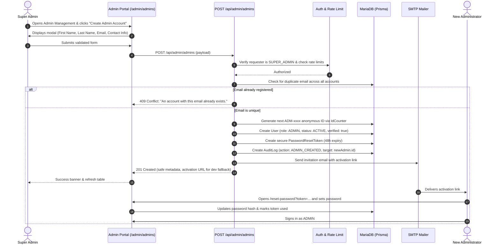

# Katuwang — Super Admin Role and Admin Account Management Plan

**Document Version:** 1.0.0  
**Date:** October 17, 2026  
**Status:** Planning & Analysis Only (Pending Review)  
**Target Application:** Katuwang Peer Tutoring Platform  

---

## 1. Executive Summary

This document presents a comprehensive, production-grade architectural plan to introduce a **Super Admin** role to the Katuwang application. 

### Core Objectives
1. **Full Privilege Inheritance:** The Super Admin inherits 100% of the capabilities, views, and permissions of the existing `ADMIN` role.
2. **Privileged Delegation:** The Super Admin gains the exclusive capability to provision and manage standard `ADMIN` accounts.
3. **Privilege Escalation Prevention:** Standard Admins, Tutors, Learners, and anonymous visitors are strictly prohibited from creating admin accounts, elevating their own role, or assigning Super Admin privileges.
4. **Zero Regression:** All existing admin workflows, moderation tables, NextAuth authentication sessions, role-based database constraints, and API routes will continue functioning without breaking changes.
5. **Secure Credential Hand-off:** Newly provisioned Admin accounts use an invitation/activation token workflow so that no actor (including the Super Admin) ever handles or views another administrator's permanent password.

---

## 2. Existing Role and Authentication Architecture

### 2.1 Role Representation in Database
- **Model:** Defined in `prisma/schema.prisma` lines 561–565:
  ```prisma
  enum Role {
    ADMIN
    STUDENT_TUTOR
    STUDENT_LEARNER
  }
  ```
- **Storage:** Persisted in MariaDB/MySQL table `users` in column `role ENUM('ADMIN', 'STUDENT_TUTOR', 'STUDENT_LEARNER') NOT NULL`.
- **Identity Scheme:** Each user is assigned a unique `anonymousId` generated via `src/lib/idGenerator.ts`.
  - Tutors: `TUT-0001`
  - Learners: `STU-0001`
  - Admins: `ADM-0001` (seeded)

### 2.2 Authentication & Session Pipeline
- **Library:** NextAuth.js v4.24.15 using `CredentialsProvider` (`src/lib/auth.ts`).
- **Session Strategy:** JWT (`strategy: "jwt"`), 8-hour max age (`maxAge: 28800`).
- **Role Ingestion:**
  - On sign-in, user credentials (email & password) are validated against bcrypt hashes (cost factor 12).
  - The JWT callback embeds `token.role = user.role` and `token.status = "ACTIVE"`.
  - **Dynamic Session Re-sync:** Every 5 minutes (`TOKEN_STALE_MS = 300000`), the `jwt` callback re-reads `role` and `status` from MariaDB, allowing role promotions, suspensions, or bans to take effect mid-session without waiting for JWT expiry.
- **Client Session Contract:** `src/types/next-auth.d.ts` exposes `session.user.role: "ADMIN" | "STUDENT_TUTOR" | "STUDENT_LEARNER"`.

### 2.3 Route Guarding & Middleware
- **Next.js Middleware Proxy (`src/proxy.ts`):**
  ```ts
  if (pathname.startsWith("/admin") && token?.role !== "ADMIN") {
    return NextResponse.redirect(new URL("/unauthorized", req.url));
  }
  ```
- **Server Component Layout Guard (`src/app/admin/layout.tsx`):**
  ```ts
  const session = await getServerSession(authOptions);
  if (!session) redirect("/login");
  if (session.user.role !== "ADMIN") redirect("/unauthorized");
  ```
- **Backend API Route Handlers:** 45+ API route handlers under `src/app/api/admin/*` repeat the inline check:
  ```ts
  const session = await getServerSession(authOptions);
  if (!session || session.user.role !== "ADMIN") {
    return NextResponse.json({ error: "Unauthorized." }, { status: 401 });
  }
  ```

---

## 3. Current Admin Permission Inventory

The existing `ADMIN` role currently has exclusive access to the following 18 functional modules:

1. **Dashboard & Analytics:** `/admin` — System metrics, active user counters, session stats.
2. **User Moderation:** `/admin/users`, `/api/admin/users/*` — Suspend, ban, or view learner and tutor accounts (Admins are currently filtered out with `role: { not: "ADMIN" }`).
3. **Registration Review:** `/admin/registrations`, `/api/admin/registrations/*` — Approve or decline new learner/tutor signups.
4. **Class Oversight:** `/admin/classes`, `/api/admin/classes/*` — Monitor tutoring classes, intervene in sessions, issue recommendations.
5. **Topic Requests:** `/admin/topic-requests`, `/api/admin/topic-requests/*` — Moderate learner-initiated topic requests.
6. **Class Appeals:** `/admin/class-appeals`, `/api/admin/class-appeals/*` — Review appeals from tutors whose classes were flagged or suspended.
7. **Abuse Reports:** `/admin/abuse-reports`, `/api/admin/abuse-reports/*` — Investigate complaints filed by students or tutors.
8. **Platform Settings:** `/admin/settings`, `/api/admin/settings` — Toggle registration status, require approval, adjust rate limits, toggle chatbot.
9. **Question Bank:** `/admin/assessment/question-bank`, `/api/admin/assessment-questions/*` — Author, update, approve, and retire certification questions.
10. **Tutor Assessments & Certifications:** `/admin/assessment/requests`, `/admin/assessment/certifications` — Grade attempts and certify tutors.
11. **Session Tests:** `/admin/session-tests`, `/api/admin/session-tests/*` — Oversee pre/post-session quizzes.
12. **Subjects & Topics:** `/admin/subjects`, `/api/admin/subjects/*` — Create, edit, and delete academic subjects and curriculum topics.
13. **Chatbot Management:** `/admin/chatbot`, `/api/admin/chatbot-misses/*` — Inspect missed chatbot queries and expand intent corpus.
14. **Audit Log:** `/admin/audit-log`, `/api/admin/audit-log/*` — View immutable administrative audit trail.
15. **System Notifications:** `/admin/notifications`, `/api/notifications/*` — Receive platform-wide alerts and incident notices.
16. **User Avatar Moderation:** `/api/admin/users/[userId]/avatar-action` — Lock or remove inappropriate profile photos.
17. **Administrative Password Change:** `/api/admin/profile/password` — Change own admin credentials.
18. **Help & FAQs:** `/admin/help` — Administrative guidance documentation.

---

## 4. Proposed Super Admin & Admin Permission Matrix

| Feature / Action | Visitor | Learner | Tutor | Admin | Super Admin |
| :--- | :---: | :---: | :---: | :---: | :---: |
| Access Public Pages (Login, Register, Home) | Yes | Yes | Yes | Yes | Yes |
| Access Learner Portal (`/learner/*`) | No | **Yes** | No | No | No |
| Access Tutor Portal (`/tutor/*`) | No | No | **Yes** | No | No |
| Access Admin Portal Base (`/admin/*`) | No | No | No | **Yes** | **Yes** |
| Moderate Users, Classes, Reports, Subjects | No | No | No | **Yes** | **Yes** |
| Grade Certifications & Manage Question Bank | No | No | No | **Yes** | **Yes** |
| Modify Platform Configuration & Settings | No | No | No | **Yes** | **Yes** |
| View System Audit Logs | No | No | No | **Yes** | **Yes** |
| **Access Admin Management View (`/admin/admins`)** | No | No | No | **No** | **Yes** |
| **Create New Admin Account** | No | No | No | **No** | **Yes** |
| **Suspend / Deactivate Admin Account** | No | No | No | **No** | **Yes** |
| **Trigger Admin Password Reset / Activation** | No | No | No | **No** | **Yes** |
| **Create Super Admin via UI or API** | **No** | **No** | **No** | **No** | **No** *(CLI Only)* |

---

## 5. Recommended Database and Role Model Changes

### 5.1 Schema Modification (`prisma/schema.prisma`)
Add `SUPER_ADMIN` to the `Role` enum in `prisma/schema.prisma`:

```prisma
enum Role {
  SUPER_ADMIN
  ADMIN
  STUDENT_TUTOR
  STUDENT_LEARNER
}
```

### 5.2 Migration Analysis
- **Database Engine:** MariaDB 10.x / MySQL 8.x.
- **SQL Statement:**
  ```sql
  ALTER TABLE `users` MODIFY COLUMN `role` ENUM('SUPER_ADMIN', 'ADMIN', 'STUDENT_TUTOR', 'STUDENT_LEARNER') NOT NULL;
  ```
- **Safety & Non-Destructive Nature:**
  - Expanding an `ENUM` in MySQL/MariaDB by appending a new value is an instantaneous metadata-only operation (`ALGORITHM=INSTANT` or fast online DDL).
  - Existing rows with `'ADMIN'`, `'STUDENT_TUTOR'`, or `'STUDENT_LEARNER'` are completely unmodified.
  - Foreign keys, indexes, and existing table data remain untouched.
- **Rollback Feasibility:**
  - If rollback is ever required:
    1. Reassign any `SUPER_ADMIN` accounts back to `ADMIN`:
       `UPDATE users SET role = 'ADMIN' WHERE role = 'SUPER_ADMIN';`
    2. Revert the column definition:
       `ALTER TABLE users MODIFY COLUMN role ENUM('ADMIN', 'STUDENT_TUTOR', 'STUDENT_LEARNER') NOT NULL;`

### 5.3 User Model Constraints & Default Values
The `User` model requires certain fields that are tailored for students: `gradeLevel` (`GradeLevel`) and `section` (`String`).
For administrator accounts:
- Existing seeded admin (`ADM-0001`) uses `gradeLevel: "GRADE_12"` and `section: "N/A"`.
- When the Super Admin provisions a new Admin account, the system will automatically supply administrative sentinel values (`gradeLevel: GradeLevel.GRADE_12` and `section: "ADMIN"`), removing the burden from the Super Admin to provide irrelevant academic student fields.

---

## 6. Proposed Frontend and Backend Changes

### 6.1 Centralized Role Authorization Module (`src/lib/permissions.ts`)
To eliminate repetitive inline checks and prevent bugs, introduce clean authorization helper utilities:

```ts
import { Role } from "@prisma/client";
import { getServerSession, Session } from "next-auth";
import { authOptions } from "@/lib/auth";
import { NextResponse } from "next/server";

export function isAdminRole(role?: string | null): boolean {
  return role === Role.ADMIN || role === Role.SUPER_ADMIN;
}

export function isSuperAdminRole(role?: string | null): boolean {
  return role === Role.SUPER_ADMIN;
}

export async function requireAdminSession(): Promise<
  { authorized: true; session: Session } | { authorized: false; response: NextResponse }
> {
  const session = await getServerSession(authOptions);
  if (!session) {
    return { authorized: false, response: NextResponse.json({ error: "Unauthorized." }, { status: 401 }) };
  }
  if (!isAdminRole(session.user.role)) {
    return { authorized: false, response: NextResponse.json({ error: "Forbidden. Admin privileges required." }, { status: 403 }) };
  }
  return { authorized: true, session };
}

export async function requireSuperAdminSession(): Promise<
  { authorized: true; session: Session } | { authorized: false; response: NextResponse }
> {
  const session = await getServerSession(authOptions);
  if (!session) {
    return { authorized: false, response: NextResponse.json({ error: "Unauthorized." }, { status: 401 }) };
  }
  if (!isSuperAdminRole(session.user.role)) {
    return { authorized: false, response: NextResponse.json({ error: "Forbidden. Super Admin privileges required." }, { status: 403 }) };
  }
  return { authorized: true, session };
}
```

### 6.2 Route Guards in Next.js Middleware (`src/proxy.ts`)
Update `src/proxy.ts` to recognize both roles for `/admin` while reserving `/admin/admins` exclusively for Super Admin:

```ts
// Super Admin only section
if (pathname.startsWith("/admin/admins") && token?.role !== "SUPER_ADMIN") {
  return NextResponse.redirect(new URL("/unauthorized", req.url));
}

// All other Admin portal sections
if (pathname.startsWith("/admin") && token?.role !== "ADMIN" && token?.role !== "SUPER_ADMIN") {
  return NextResponse.redirect(new URL("/unauthorized", req.url));
}
```

### 6.3 Portal Navigation & Layout (`src/app/admin/layout.tsx`)
1. Update authorization check:
   ```ts
   if (!session || !isAdminRole(session.user.role)) {
     redirect("/unauthorized");
   }
   ```
2. Conditionally inject the **Admin Accounts** navigation item only when `session.user.role === "SUPER_ADMIN"`:
   ```ts
   const isSuperAdmin = session.user.role === "SUPER_ADMIN";
   const navItems: NavItem[] = [
     ...ADMIN_NAV_ITEMS,
     ...(isSuperAdmin
       ? [{ label: "Admins", href: "/admin/admins", icon: <ShieldCheck className="w-4 h-4" />, group: "Administration" }]
       : []),
   ];
   ```

### 6.4 Moderation List Separation (`src/app/api/admin/users/route.ts`)
Currently, `/api/admin/users` queries `{ role: { not: "ADMIN" } }` so that staff don't appear in the student/tutor moderation table.
Update the filter to exclude both administrative roles:
```ts
role: role && role in Role ? (role as Role) : { notIn: [Role.ADMIN, Role.SUPER_ADMIN] },
```

### 6.5 Avatar Privacy Policy (`src/lib/avatarPrivacy.ts`)
Ensure `SUPER_ADMIN` inherits full avatar visibility privileges identical to `ADMIN`:
```ts
if (viewerRole === "ADMIN" || viewerRole === "SUPER_ADMIN") return true;
```

---

## 7. Admin Account Creation Workflow



### 7.1 Input Validation Schema (`src/lib/validations/admin.ts`)
```ts
export const createAdminAccountSchema = z.object({
  firstName: z.string().trim().min(1, "First name is required.").max(50),
  lastName: z.string().trim().min(1, "Last name is required.").max(50),
  email: z.string().trim().email("Enter a valid email address.").toLowerCase(),
  contactInfo: z.string().trim().max(100).optional().nullable(),
});
```
*Note: The schema does not accept a `role` parameter. The backend hardcodes `role: Role.ADMIN` upon creation, completely thwarting parameter manipulation attacks.*

### 7.2 Credential Hand-off Recommendation: Activation Token Flow
- **Why NOT Super Admin-chosen passwords?** If the Super Admin chooses a password, two people know the credentials, violating non-repudiation and enterprise security best practices.
- **Why NOT plaintext temporary passwords in emails?** Plaintext passwords in email inboxes risk interception and exposure.
- **The Secure Invitation Pattern:**
  1. The server generates a random 64-character hex token using `crypto.randomBytes(32).toString("hex")`.
  2. The SHA-256 hash is saved to `PasswordResetToken` with `expiresAt: 48 hours`.
  3. The invitation email directs the new Admin to set their password through the existing password reset interface (`/reset-password?token=<rawToken>`).
  4. For local development or environments without SMTP configured, the API response returns `{ activationUrl: "..." }` displayed inside a secure copy box to the Super Admin.

---

## 8. Initial Super Admin Provisioning Strategy

To maintain strict security:
- **No Self-Registration:** There will be **no public endpoint** or registration form field to become a Super Admin.
- **No Client Elevation:** Client requests can never promote any account.
- **First Registered User Rule:** The first user to register does **not** get Super Admin automatically.

### Provisioning Method 1: Dedicated Server CLI Script (`scripts/promote-super-admin.ts`)
The primary provisioning path in production is a dedicated Node CLI script run directly on the server host:

```bash
# Syntax:
pnpm exec tsx scripts/promote-super-admin.ts <admin-email>

# Example:
pnpm exec tsx scripts/promote-super-admin.ts admin@katuwang.edu.ph
```

**Script Logic:**
1. Validates that the target account exists and currently holds the `ADMIN` role.
2. Prompts the CLI operator for explicit confirmation.
3. Atomically updates `User.role = "SUPER_ADMIN"`.
4. Writes an `AuditLog` entry with `action: "SUPER_ADMIN_PROMOTED"`, recording the timestamp and CLI actor.
5. NextAuth's 5-minute periodic re-sync (`TOKEN_STALE_MS`) immediately picks up the role update for active sessions.

### Provisioning Method 2: Development & Seed Environment (`prisma/seed.ts`)
For automated CI and local development testing:
- Update `prisma/seed.ts` to seed both roles:
  - `admin@katuwang.test` (`ADM-0001`): Standard `ADMIN` role (to test permission restrictions).
  - `superadmin@katuwang.test` (`ADM-0000`): `SUPER_ADMIN` role (to test admin creation capabilities).

---

## 9. Security Risks and Mitigations

| Threat / Risk | Attack Vector | Technical Safeguard |
| :--- | :--- | :--- |
| **Privilege Escalation** | Admin sends POST request to `/api/admin/admins` to create another admin or promote themselves | Enforced by `requireSuperAdminSession()`: returns HTTP 403 Forbidden. Session role verified on every invocation. |
| **Role Payload Tampering** | Attacker injects `{ role: "SUPER_ADMIN" }` into user registration or profile update payload | Zod schemas strip unrecognized fields (`strip()`); API route ignores client role and strictly binds `Role.ADMIN`. |
| **Admin Hijacking** | Super Admin sets a weak password or intercepts employee credentials | Zero-knowledge invitation token flow: Super Admin never sees or sets the new Admin's password. |
| **Duplicate / Orphan Accounts** | Rapid double-clicks or concurrent requests with the same email | Database unique constraint on `users.email` combined with transactional uniqueness check and atomic `IdCounter` increment. |
| **Credential Stuffing / Brute Force** | Repeated calls to Admin API or login | `rateLimit()` applied by IP and email prefix; standard NextAuth timing-safe dummy hash comparison. |
| **Audit Log Tampering** | Admin actions executed without traceability | Mandatory `prisma.auditLog.create` transaction executed alongside user creation. Admins cannot edit or delete audit logs. |
| **Stale Session Abuse** | Demoted/suspended admin continues using old JWT token | NextAuth JWT callback re-queries database every 5 minutes (`TOKEN_STALE_MS`); `src/proxy.ts` cuts off inactive accounts on the next request. |

---

## 10. Frontend Planning: Pages and Components

```
src/
├── app/
│   └── admin/
│       └── admins/                          [NEW] Super Admin Admin Management Page
│           └── page.tsx
├── components/
│   └── admin/
│       ├── AdminManagementTable.tsx         [NEW] Table listing all Admin & Super Admin accounts
│       ├── CreateAdminModal.tsx             [NEW] Accessible modal form to create Admin accounts
│       └── AdminStatusBadge.tsx             [NEW] Visual badge distinguishing Super Admin & Admin
```

### Component Details
1. **`AdminManagementTable.tsx`:**
   - Displays all users with `role: "ADMIN"` or `role: "SUPER_ADMIN"`.
   - Columns: Anonymous ID (`ADM-xxxx`), Full Name, Email, Role (`Super Admin` vs `Admin`), Status (`Active` / `Suspended`), Creation Date, and Actions.
   - Action dropdown:
     - Resend Activation Link (if password has not been initialized).
     - Suspend / Reactivate Admin Account.
     - *Self-protection:* A Super Admin cannot suspend or delete their own active account.
2. **`CreateAdminModal.tsx`:**
   - Modal dialog with First Name, Last Name, Email, and Contact Number.
   - Form state handling with optimistic loading spinner and disabled submit button to prevent double submissions.
   - Displays activation URL box if SMTP email delivery is disabled in local environment.

---

## 11. Testing and Regression Plan

### 11.1 Automated Unit & Integration Tests

Create a dedicated test file: `src/app/api/admin/admins/__tests__/route.test.ts`

- [ ] **Test 1: Super Admin Access:** Super Admin (`role: "SUPER_ADMIN"`) receives HTTP 200 and lists all admin accounts.
- [ ] **Test 2: Super Admin Creation:** Super Admin can create a new Admin account; verify `role: "ADMIN"`, `anonymousId: "ADM-xxxx"`, status `"ACTIVE"`, and audit log entry created.
- [ ] **Test 3: Admin Rejection (Negative):** Standard Admin (`role: "ADMIN"`) receives HTTP 403 Forbidden when calling `POST /api/admin/admins`.
- [ ] **Test 4: Learner/Tutor Rejection (Negative):** Non-admin roles receive HTTP 401/403 when accessing admin routes.
- [ ] **Test 5: Unauthenticated Rejection (Negative):** Missing session receives HTTP 401 Unauthorized.
- [ ] **Test 6: Role Tampering (Negative):** Submitting payload `{ firstName: "Jane", email: "...", role: "SUPER_ADMIN" }` ignores the role input and still creates `role: "ADMIN"`.
- [ ] **Test 7: Duplicate Email Rejection (Negative):** Attempting to create an admin with an existing user's email returns HTTP 409 Conflict.
- [ ] **Test 8: Validation Error (Negative):** Submitting invalid email or missing name returns HTTP 400 Bad Request with field error.

### 11.2 Manual Verification Checklist
- [ ] Log in as `admin@katuwang.test` (`ADMIN`): Verify sidebar **does not show** "Admins" link.
- [ ] Directly navigate to `/admin/admins` as `ADMIN`: Verify immediate redirection to `/unauthorized`.
- [ ] Log in as `superadmin@katuwang.test` (`SUPER_ADMIN`): Verify sidebar **shows** "Admins" link.
- [ ] Super Admin navigates to `/admin/admins` and creates a new admin (`testadmin@katuwang.test`).
- [ ] Verify database record created with `role: "ADMIN"`, `anonymousId: "ADM-0002"`.
- [ ] Verify activation link functions; complete password setup as new admin.
- [ ] Log in as the new admin; verify access to standard admin features (`/admin/classes`, `/admin/users`, etc.).
- [ ] Verify new admin cannot access `/admin/admins`.

---

## 12. Detailed Implementation Phases

When approved for execution, implementation should proceed in four sequential phases:

### Phase 1: Database & Foundation
1. Update `prisma/schema.prisma` with `SUPER_ADMIN` in `enum Role`.
2. Generate migration: `prisma migrate dev --name add_super_admin_role`.
3. Update `src/types/next-auth.d.ts` to include `"SUPER_ADMIN"`.
4. Update `src/lib/idGenerator.ts` to support atomic `ADM` prefixes.
5. Create `src/lib/permissions.ts` with reusable role validation helpers.

### Phase 2: Route Protection & Backend API
1. Update `src/proxy.ts` middleware with `isAdminRole` and `/admin/admins` guard.
2. Update `src/lib/avatarPrivacy.ts` to grant `SUPER_ADMIN` avatar viewing.
3. Update `src/app/api/admin/users/route.ts` to exclude both admin roles from learner moderation.
4. Implement `src/app/api/admin/admins/route.ts` (GET list, POST create).
5. Implement `src/app/api/admin/admins/[adminId]/route.ts` (PATCH suspend/activate).

### Phase 3: Frontend Interface & Layout
1. Update `src/app/admin/layout.tsx` to conditionally show the "Admins" nav item.
2. Build `src/app/admin/admins/page.tsx`.
3. Build `src/components/admin/AdminManagementTable.tsx`.
4. Build `src/components/admin/CreateAdminModal.tsx`.

### Phase 4: CLI Provisioning, Seed & Verification
1. Create `scripts/promote-super-admin.ts`.
2. Update `prisma/seed.ts` with test Super Admin account.
3. Write comprehensive unit test suite in `src/app/api/admin/admins/__tests__/route.test.ts`.
4. Run full test suite (`pnpm test`), typecheck (`tsc --noEmit`), lint (`eslint`), and production build (`pnpm build`).

---

## 13. Assumptions and Dependencies

1. **Email Delivery Configuration:** In production, SMTP settings (`SMTP_HOST`, `SMTP_USER`, `SMTP_PASS`) must be valid for automated activation emails. The implementation will include a fallback on-screen activation link for local development.
2. **Database Permissions:** The database connection user must have DDL rights (`ALTER TABLE`) to apply the schema migration.
3. **Anonymity Policy:** Admins do not require anonymous ID masking from each other in the Admin Portal; real names and official school emails are visible in `AdminManagementTable` to facilitate accountability.
