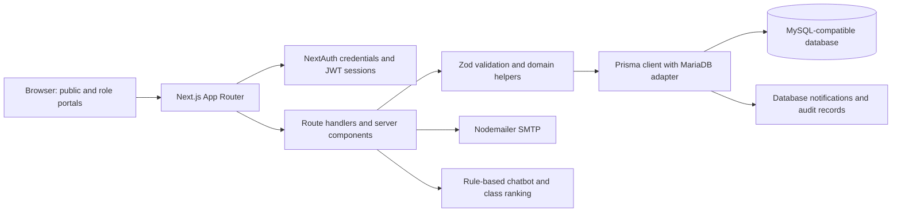
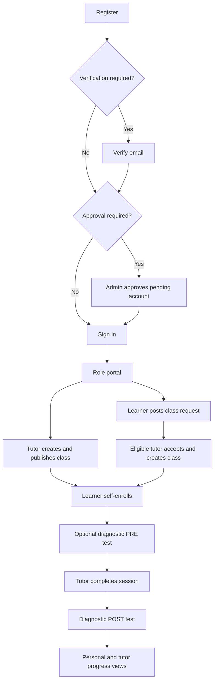

# System overview and architecture

## Application purpose

Katuwang is a school peer-tutoring application for grades 7–12. Learners discover tutoring classes, compare ranked matches, request classes, enroll, and measure progress through session PRE/POST tests. Student Tutors schedule classes and individual meetings, respond to learner requests, obtain topic certifications through quizzes or review, and inspect anonymized learner results. Administrators govern accounts, registrations, taxonomy, certification content, moderation, appeals, reports, and platform settings.

Peer-facing interfaces normally use anonymous identifiers. This is an application presentation policy, not full anonymity: administrators can inspect account identity, and several APIs carry opaque user identifiers and grade/section. The optional tutor-name setting relaxes tutor identity display.

## Identified roles and access scopes

| Actor | Code evidence | Scope |
| --- | --- | --- |
| Guest/applicant | Public pages; `/api/register`; `/api/auth/*` | Landing/privacy pages, learner/tutor registration, sign-in, email verification, password recovery, account-state guidance |
| Student Learner | `Role.STUDENT_LEARNER`; learner layout and API role checks | Learner portal; own requests/enrollments/reports/attempts/progress/profile; eligible tutor/class discovery |
| Student Tutor | `Role.STUDENT_TUTOR`; tutor layout and API role checks | Tutor portal; own classes/sessions/custom questions, certifications/quiz attempts; eligible learner requests and own student roster |
| Admin | `Role.ADMIN`; admin layout and API role checks | Platform oversight and configuration, non-admin account moderation, global class and assessment review, audit and operational reports |
| Developer/operator context | `NODE_ENV` checks, seed commands | Non-production preview/login pages; factory API additionally requires Admin; database provisioning through scripts |

Roles are exclusive scalar values on `User`, not a hierarchy. Admins do not automatically pass Learner/Tutor API checks. There is no current Manager, parent, Teacher, or Moderator role. A historical migration removes `TEACHER_MODERATOR`.

## Runtime components

[package.json](../../package.json) declares Next.js 16.2.12, React 19.2.4, TypeScript, NextAuth 4, Prisma 7, Zod 4, Recharts, Tailwind 4 and DaisyUI 5. [prisma.ts](../../src/lib/prisma.ts) instantiates Prisma using `PrismaMariaDb` and `DATABASE_URL`; the datasource provider is `mysql`. This is a single application with in-process domain helpers, not separate frontend/backend microservices.

Server components load page context directly from Prisma. Client components submit JSON through route handlers and refresh lists or navigation. Shared UI primitives implement pagination, sort controls, dialogs, validation feedback, schedules and charts. SMTP sends account verification/reset messages. Notifications are rows in the application database; there is no notification delivery queue, websocket server, or background worker in the inspected implementation.

## Authentication and authorization

1. Credentials sign-in loads the email account and compares a bcrypt hash. Missing-user and wrong-password paths use the same error; a dummy hash comparison reduces timing differences.
2. An expired timed account suspension is lifted during sign-in. Suspended/banned accounts are denied.
3. When enabled, email verification is checked before pending/declined approval status. `ACCOUNT_UNVERIFIED`, `ACCOUNT_PENDING`, and `ACCOUNT_DECLINED[:reason]` drive dedicated UI pages.
4. Successful sign-in issues an eight-hour JWT session with ID, anonymous ID, role, full name, and status. The JWT callback refreshes role/status from the database after five minutes; a missing user becomes effectively banned.
5. [proxy.ts](../../src/proxy.ts) protects `/dashboard`, `/admin`, `/tutor`, and `/learner`; inactive token status redirects to login, and wrong roles redirect to `/unauthorized`. Portal layouts repeat session/role checks.
6. APIs perform their own session/role checks and resource ownership checks. The proxy matcher does **not** cover `/api`; most handlers do not reject an inactive `session.user.status`. See the caveats before treating page guards as universal API enforcement.

## Data domains

| Domain | Models and important relations |
| --- | --- |
| Identity | `IdCounter` allocates public identifiers; `User` has unique email/anonymous ID, one role, grade/section, consent, verification and moderation fields; Tutor has one `TutorProfile` |
| Account tokens | `PasswordResetToken`, `VerificationToken`: SHA-256 hashes, expiry, single-use timestamps; cascade with User |
| Taxonomy | `Subject` with immutable stored slug; child `Topic` names/order/active flags. Business records store subject/topic strings rather than taxonomy foreign keys |
| Teaching | `TutorClass` belongs to TutorProfile; children `ClassTopic`, `ClassSession`, `ClassEnrollment`; unique learner/class enrollment |
| Matching demand | `TopicRequest` belongs to learner; child topics and preferred weekly slots; optional directed TutorProfile and linked fulfilled class |
| Certification | Unique TutorProfile/subject/topic `TopicCertification`; `AssessmentAttempt` with numbered attempts and ordered `AssessmentAttemptItem` |
| Question content | `AssessmentQuestion`, ordered `AssessmentOption`; `BANK` versus tutor-owned `TUTOR` origin; `QuestionRequest` tracks bank requests |
| Session measurement | One `SessionTest` per meeting; ordered `SessionTestQuestion`; one PRE and one POST `SessionTestAttempt` per learner/test with ordered items |
| Governance | `ClassAppeal`, `Report`/`ReportViolation`, `AuditLog`, `PlatformSetting` |
| Communication | `Notification`, informational `ClassRecommendation`, unmatched-query `ChatbotMiss` |

The authoritative fields, enum values, uniqueness and cascade constraints are in [schema.prisma](../../prisma/schema.prisma). Migrations document historical changes; the current schema/routes determine this guide's behavior.

## Main business workflows

Class-request lifecycle: `OPEN → ACCEPTED → ENROLLED → FULFILLED`. Leaving returns ENROLLED to ACCEPTED. Tutor cancellation/deletion or admin banning can reopen eligible linked requests. Learners/admins can close requests under specific rules.

Tutor certification lifecycle: request/quiz creates `PENDING`, quiz failure gives `REJECTED`, and admin approval or configured auto-certification gives `CERTIFIED`. A passed quiz with auto-certification disabled still awaits admin confirmation.

## Operational boundaries

Commands: `pnpm dev`, `pnpm build`, `pnpm start`, `pnpm lint`, `pnpm test`, `pnpm test:watch`; install triggers `prisma generate`. `prisma.config.ts` selects schema, migration path and `tsx prisma/seed.ts`. Seed scripts are manual operator actions, not scheduled application features. No payment, built-in video conferencing, file-upload workflow, peer messaging, cron service or webhook handler was found in current routes. Meeting links refer to external services.
