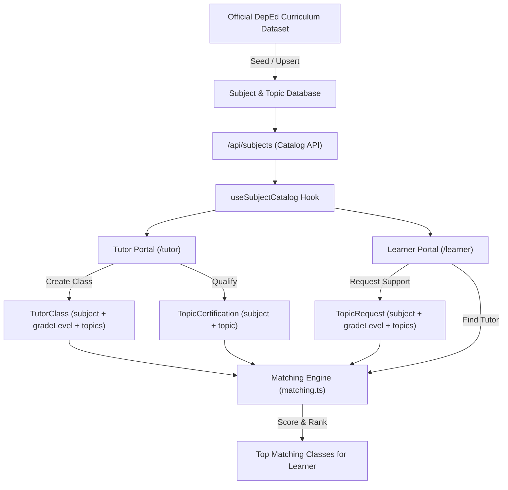

# Database Integration Plan: Philippine K–12 Curriculum in Katuwang

**Project:** Katuwang Peer Tutoring Platform  
**Target School:** Taysan Resettlement Integrated School (TRIS), Legazpi City, Albay  
**Date:** October 2026  
**Status:** Phase 1 (Catalogue Expansion) Implemented; Phase 2 (3NF Competency Schema) Proposed  

---

## 1. Architectural Review of the Existing Katuwang System

Katuwang's data layer uses **Next.js 16, TypeScript, Prisma ORM (v7.8.0), and MariaDB/MySQL**.

Following the architectural decision documented in `docs/plans/subject-topic-management.md` (Path B):
1. **Catalog Tables:** The taxonomy is backed by `Subject` and `Topic` tables in the database:
   - `Subject`: `id`, `slug` (`@unique`), `name` (`@unique`), `order`, `active`, `createdAt`, `updatedAt`, `topics Topic[]`.
   - `Topic`: `id`, `subjectId`, `name`, `order`, `active`, `createdAt`, `subject Subject` (`@@unique([subjectId, name])`, `@@index([subjectId, active])`).
2. **Denormalized Foreign References:**
   - To avoid brittle foreign-key rewrites and backfills across ~38 files, six primary models store `subject` as a `String` slug:
     - `TutorClass.subject`
     - `TopicRequest.subject`
     - `TopicCertification.subject`
     - `AssessmentQuestion.subject`
     - `AssessmentAttempt.subject`
     - `QuestionRequest.subject`
   - Topics are stored as string topic names on:
     - `ClassTopic.topic`
     - `ClassSession.topic`
     - `TopicRequestTopic.topic`
     - `TopicCertification.topic`
     - `AssessmentQuestion.topic`
     - `AssessmentAttempt.topic`
     - `QuestionRequest.topic`
3. **Grade Level Support:**
   - `TutorClass.gradeLevel` (`GradeLevel?`) and `TopicRequest.gradeLevel` (`GradeLevel`) already exist in the schema, using the `GradeLevel` enum (`GRADE_7` through `GRADE_12`).
4. **Current Live State:**
   - The production/development database contains **299 users, 170 tutor classes, 307 topic certifications, 160 learner topic requests, and 646 assessment questions**.
   - **Crucial Invariant:** Any curriculum integration must preserve all existing records and keep all previously seeded subject slugs (`MATH`, `ENGLISH`, `SCIENCE`, `FILIPINO`, `ARALING_PANLIPUNAN`, `TLE`, `MAPEH`) and their 43 original topics intact.

---

## 2. Logical Curriculum Hierarchy

The desired logical model for the Philippine K–12 curriculum is:

$$\text{Grade Level} \longrightarrow \text{Subject} \longrightarrow \text{Topic} \longrightarrow \text{Subtopic} \longrightarrow \text{Learning Competency}$$

### Multi-Grade & Cross-Curriculum Accommodations
- **Multi-Grade Core Subjects:** In Junior High School, subjects like `MATH` and `SCIENCE` are taken across Grades 7, 8, 9, and 10. Rather than creating four duplicate subjects (`MATH_7`, `MATH_8`, etc.), the system maintains a unified subject slug `MATH` with distinct, grade-stratified topics (e.g., `Polygons & Angle Properties` for Grade 7, `Special Products & Factoring` for Grade 8, `Quadratic Equations & Functions` for Grade 9, `Circle Theorems & Coordinate Geometry` for Grade 10).
- **Senior High School Course Specificity:** In Senior High School, subjects represent discrete semester-length courses with distinct learning competencies (e.g., General Mathematics vs. Pre-Calculus vs. Business Mathematics). These are assigned specific subject slugs (e.g., `SHS_GENMATH`, `SHS_STEM_PRECALC`, `SHS_ABM_BUSMATH`).
- **Curriculum Versions:** Every learning competency is tagged with its official version (`MATATAG_2024`, `K12_2016`, `SHS_2016`, or `SSHS_2024`) and source provenance.

---

## 3. Two-Phase Integration Strategy

### Phase 1: Catalogue Expansion (Implemented & Verified ✅)
In Phase 1, the official curriculum is integrated directly into the existing `Subject` and `Topic` tables using the repeatable seed script `prisma/seedCurriculum.ts`:
- **Subject Expansion:** Upserted all 47 official DepEd subjects (8 JHS learning areas, 15 SHS Core, 7 SHS Applied, 11 Academic Specialized, and 6 TVL Specializations).
- **Topic Expansion:** Upserted 155 curated curriculum topics.
- **Backward Compatibility:** All 43 pre-existing topics for `MATH`, `SCIENCE`, `ENGLISH`, etc., are strictly preserved, ensuring that none of the 307 certifications or 646 assessment questions are orphaned.
- **Zero Schema Disruption:** Requires no changes to `schema.prisma` or database migrations, allowing immediate runtime consumption by `useSubjectCatalog()`, `GET /api/subjects`, `src/lib/subjects.ts`, and the matching engine `src/lib/matching.ts`.

### Phase 2: Normalized 3NF Competency Extension (Proposed for Confirmation 📋)
To support subtopics, learning competency codes, and official source citations at the database level in strict Third Normal Form (3NF), we propose introducing the `CurriculumCompetency` model.

#### Proposed Prisma Schema Addition:
```prisma
model CurriculumCompetency {
  id                  String     @id @default(cuid())
  topicId             String
  gradeLevel          GradeLevel
  quarterOrTerm       String     // e.g. "Term 1", "Quarter 2"
  subtopic            String?
  code                String?    // e.g. "MATATAG-M7MG-T1-W1", "STEM_PC11AG-Ia-1"
  statement           String     @db.Text
  curriculumVersion   String     // "MATATAG_2024", "K12_2016", "SHS_2016"
  trackOrStrand       String?    // "JHS", "SHS_CORE", "ACADEMIC_STEM", "TVL_ICT"
  sourceTitle         String
  sourceUrl           String
  pageNumber          String?
  verificationStatus  String     @default("VERIFIED")
  createdAt           DateTime   @default(now())
  updatedAt           DateTime   @updatedAt

  topic               Topic      @relation(fields: [topicId], references: [id], onDelete: Cascade)

  @@unique([topicId, code, gradeLevel])
  @@index([gradeLevel, topicId])
  @@index([curriculumVersion])
  @@map("curriculum_competencies")
}
```

#### Why this schema satisfies 3NF:
1. **1NF:** All attributes are atomic; no repeating groups or comma-separated lists.
2. **2NF:** Every non-key attribute is fully functionally dependent on the primary key `id`.
3. **3NF:** No non-key attribute is transitively dependent on another non-key attribute. `topicId` links directly to the parent `Topic`, and the topic links to `Subject`.

---

## 4. Tutor and Tutee Workflow Integration

The enriched curriculum dataset directly powers Katuwang's core peer mentoring features:



### 1. Tutor Class Creation & Certification
- Tutors select their subject (e.g. `SHS_STEM_PRECALC`), which dynamically populates curriculum topics (`Conic Sections & Systems of Nonlinear Equations`, `Circular Functions & Trigonometric Identities`).
- Tutors must pass a qualifying quiz authored for that specific topic before receiving `CERTIFIED` status.
- Tutors are **not** blanket-certified for all topics within a subject merely by selecting that subject.

### 2. Learner Academic Need Specification
- Learners specify their current `gradeLevel` (e.g. `GRADE_11`), desired subject (e.g. `General Mathematics`), and the specific topic or difficulty (e.g. `Functions & Rational Functions`).
- If no active class fits, learners submit a `TopicRequest` with their preferred time slots.

### 3. Matching Algorithm Execution
- The matching engine (`src/lib/matching.ts` → `scoreClass` and `rankMatches`) evaluates:
  1. **Hard Subject Match:** `klass.subject === criteria.subject`.
  2. **Topic Overlap:** `criteria.topics.filter(t => klass.topics.includes(t))`.
  3. **Verified Topic Bonus:** +5 points per matched topic where tutor is `CERTIFIED`.
  4. **Grade Level Proximity:** +6 points for exact grade match (`GRADE_11` vs `GRADE_11`), +3 for adjacent grade (`GRADE_11` vs `GRADE_12`).
  5. **Schedule & Soonness:** Upcoming session fit within preferred slots.

---

## 5. Duplicate Prevention & Curriculum Maintenance

### Idempotent Seed Process
The import script (`prisma/seedCurriculum.ts`) uses Prisma's atomic `upsert`:
```ts
await prisma.subject.upsert({
  where: { slug },
  update: { name: data.name, order: sOrder, active: true },
  create: { slug, name: data.name, order: sOrder, active: true },
});

await prisma.topic.upsert({
  where: { subjectId_name: { subjectId: subject.id, name: topicName } },
  update: { order: tOrder, active: true },
  create: { subjectId: subject.id, name: topicName, order: tOrder, active: true },
});
```
- Running `pnpm exec tsx prisma/seedCurriculum.ts` repeatedly causes zero duplicates and zero record churn.
- Topic names are trimmed and normalized via `src/lib/subjectTopics.ts:normalizeTopic()`.

### Handling Future DepEd Curriculum Updates
When DepEd updates learning competencies (e.g., when Grade 10 completes MATATAG transition in SY 2027–2028 or when Senior High School revision is fully promulgated):
1. New competency records are added to `prisma/data/curriculum/curriculum_dataset.json` with version `MATATAG_2027`.
2. Existing subject slugs and historical topic names remain untouched so past session test results, pre/post gain statistics, and tutor certification records remain historically accurate.
3. Obsolete topics can be marked `active: false` in the database, cleanly hiding them from new dropdowns while preserving existing relations.
